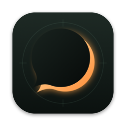

<p align="center">
  
</p>

# Umbra

Tactical end-to-end encrypted chat for IP networks without internet access.

Umbra gives a team direct messages and chat rooms over relay servers it runs itself. Normally the server is a Linux or macOS computer; in the field, a phone running the app can be the server. Setup is scanning QR codes: one for the server, one per contact, one per room. Nothing goes through Apple, Google or any other third party, and nothing is logged.

## Features

- **End-to-end encryption.** Direct messages use the Double Ratchet (Signal's design), with forward secrecy and post-compromise security. Rooms use a shared 256-bit secret. Every message is signed by its sender.
- **QR code setup.** Scan a server, a contact or a room, and it's configured. Every code is also an `umbra://` link that can be pasted or shared instead; on Mac and Vision Pro, which have no camera scanner in the app, a QR code can also be read from an image file. Server QR codes also come as a JPEG for printing.
- **Your own servers.** A single static Linux binary, the macOS app, or an iPhone/iPad hosting from the app.
- **Two server modes.** *Relay* only forwards to clients that are online and keeps nothing. *Store* holds encrypted messages for offline members until a time limit expires.
- **No logs, minimal metadata.** Servers see only opaque routing tags that rotate daily. They can't read messages or tell who is talking to whom.
- **Works offline.** No internet, no DNS and no push services needed. Any IP network will do: LAN, Wi-Fi, a phone hotspot, a VPN, or a VPS when internet is available.
- **Delivery receipts**, an encrypted vault, optional message auto-delete, and *Wipe everything*.
- **Rooms to contacts.** Long-press (or right-click) a room message to add its sender as a contact; they get a contact request.

## Platforms

| Component | Runs on |
|---|---|
| App | iOS / iPadOS 16+, macOS 13+, visionOS 1+ |
| Server in the app | Same as the app (a phone host has to stay in the foreground) |
| `umbra-server` | Linux x86_64 and aarch64 (static binaries, any distribution), macOS |

iOS 16 is supported so that older phones (iPhone 8 and X) can be endpoints. See [Known limits](#known-limits) for what that costs.

## Install

Everything is on the [latest release](https://github.com/HenriVSL/Umbra/releases/latest) page.

**App (iPhone and iPad).** Download the unsigned `.ipa` and sideload it with a tool that re-signs it with your own Apple ID, such as [AltStore](https://altstore.io), [SideStore](https://sidestore.io) or [Sideloadly](https://sideloadly.io). With a free Apple ID the signature expires after 7 days, so the app has to be re-signed weekly (AltStore and SideStore can refresh it for you). The app is multiplatform, but the `.ipa` covers iOS and iPadOS only; for macOS and visionOS, [build from source](#build-from-source).

**Server (Linux).** The same page has static `umbra-server` binaries for `x86_64` and `aarch64`, plus `SHA256SUMS`:

```sh
sha256sum -c --ignore-missing SHA256SUMS
chmod +x umbra-server-linux-x86_64
./umbra-server-linux-x86_64 --help
```

They have no runtime dependencies and run on any distribution. See [Running a server](#running-a-server) for the options, and note the last item under [Known limits](#known-limits).

## Repository layout

```
Umbra/                 SwiftUI app (one multiplatform target)
  Model/               AppModel, vault, server connections, in-app host
  Views/               UI
  Assets.xcassets      app icon (iOS/macOS icon set, visionOS layered stack)
UmbraKit/              Swift package shared by the app and the server
  UmbraCore            crypto, Double Ratchet, wire protocol, invites
                       (CryptoKit on Apple platforms, swift-crypto on Linux)
  UmbraNet             TCP framing on SwiftNIO
  UmbraServer          zero-log relay: also embedded in the app
  UmbraClient          client connection and sync
  UmbraQR              QR encoder plus terminal and JPEG output, no dependencies
  umbra-server         command-line server
scripts/
  build-linux.sh       cross-compiles static Linux server binaries into dist/
  render-icon.swift    draws the app icon
```

## Quick start

1. **Start a server.** On a Linux machine with a public IP (binaries under [Install](#install)):
   ```sh
   umbra-server --name FOB --mode store --persist --retention 3d --no-announce
   ```
   It shows the invite as a QR code in the terminal and writes `~/.umbra-server/invite-qr.jpg`.
   Or, in the app: **Servers → Host a server on this device**.
2. **Join it.** In the app, create an identity, then go to **Servers → Add server by code** and scan the server QR.
3. **Add contacts.** Scan someone's code from their **Me** tab. They get a contact request and accept it with one tap.
4. **Open rooms.** Go to **Chats → + → New room**, then show the room QR or send it over an encrypted DM.

## Build from source

Requirements: Xcode 27 and Swift 6.

```sh
git clone https://github.com/HenriVSL/Umbra.git
cd Umbra
```

### App (iOS, macOS, visionOS)

Open `Umbra.xcodeproj`, choose your team under *Signing & Capabilities*, and run the **Umbra** scheme. From the command line:

```sh
xcodebuild -project Umbra.xcodeproj -scheme Umbra -configuration Release \
  -destination 'generic/platform=iOS' -allowProvisioningUpdates build
```

**Mac:** build with `-destination 'platform=macOS'`, then copy `Release/Umbra.app` from the build products to `/Applications`.

**Devices on iOS 16:** Xcode 27 only installs to and debugs devices on iOS 17 or later. An iOS 16 phone shows up in `devicectl` only by ECID and never as a run destination. Build for *Any iOS Device* as above, then install over USB with libimobiledevice:

```sh
brew install ideviceinstaller
ideviceinstaller install ~/Library/Developer/Xcode/DerivedData/Umbra-*/Build/Products/Release-iphoneos/Umbra.app
```

The device must be in the team's provisioning profile and have Developer Mode on (`idevicedevmodectl list`). Crash reports come off the device with `idevicecrashreport -k -e <dir>`.

### Server

- **Linux, from a Mac:** `scripts/build-linux.sh` cross-compiles fully static binaries, `dist/umbra-server-linux-x86_64` and `-aarch64` (about 60 MB each), and writes `dist/SHA256SUMS`. They have no runtime dependencies: copy the file to the machine, `chmod +x` it, and run it. The script header lists the one-time toolchain setup (the swift.org toolchain plus the Static Linux SDK).
- **Native build** on Linux or macOS:
  ```sh
  cd UmbraKit && swift build -c release --product umbra-server
  ```

## Running a server

```
umbra-server [options]

  --name <name>          Server name shown to users            (default: Umbra)
  --listen <addr>        Address to bind                       (default: 0.0.0.0)
  --port <port>          TCP port                               (default: 7443)
  --public-host <host>   Address clients dial, put in the QR: an IP, a DNS name, or "auto"
                         (default: a public address on this machine, else the first LAN IPv4)
  --mode relay|store     relay: forward only, nothing retained  (default: relay)
                         store: hold encrypted blobs until TTL
  --retention <dur>      Store-mode TTL, e.g. 12h, 7d           (default: 7d)
  --persist              Store mode: keep an encrypted snapshot next to the key file
  --max-store <MB>       Store mode: memory cap, oldest evicted first  (default: 256)
  --open                 No access key: anyone with the server key may connect
  --no-announce          Don't announce on the LAN (Bonjour)
  --data-dir <path>      Holds server.key (0600)                (default: ~/.umbra-server)
  --rotate-access-key    Generate a new access key (revokes every issued QR)
  --qr-file <path>       Where to write the invite QR as JPEG   (default: <data-dir>/invite-qr.jpg)
  --no-qr-file           Don't write the JPEG
  --print-invite         Print the invite even when output isn't a terminal
```

| Mode    | Behaviour |
|---------|-----------|
| `relay` | Forwards to connected subscribers only. Nothing is retained. If the recipient is offline, the message is lost (the sender's app shows it as sent to the server). |
| `store` | Also keeps encrypted blobs in RAM until the TTL expires. Add `--persist` to keep an encrypted snapshot across restarts. |

- **No logs.** The server prints its configuration and invite once at startup and nothing else: no IPs, no tags, no timing. In a terminal the invite appears as a link and a QR code. When output goes to a log (systemd, a pipe), the invite is *not* printed, so it never lands in a journal; `--print-invite` overrides this.
- **Invite QR as JPEG.** Written at every start to `<data-dir>/invite-qr.jpg` (mode 0600) for printing or showing on a screen. The image grants use of the server, so handle it like a password.
- **Which address goes in the QR** (`--public-host`). The startup line `Clients dial: <host>:<port> (<reason>)` shows which address was chosen and why.
  - *Not set:* a public address on one of this machine's interfaces (typical for a VPS), otherwise the first LAN address. Makes no network requests, so it's the right choice without internet.
  - `auto`: as above, but behind NAT it asks a STUN server (Cloudflare, then Google; one UDP packet each) which public address it appears from, and reminds you to forward the port on the router. It checks again every 10 minutes and writes a new QR if the address changes. With no internet it falls back to the LAN address. This is the only mode that contacts anything outside your network. Without a working DNS server, startup can be delayed by a DNS timeout.
  - *An IP or DNS name:* used as given. A DNS name (for example dynamic DNS) is best when the public IP changes, because clients that already scanned the QR can't follow a new IP over the internet.
- **Access control.** By default a random access key is embedded in the server QR. Clients must prove they hold it in their very first message, and the server sends nothing at all to clients that can't, so a port scan can't identify it. `--rotate-access-key` revokes every issued QR; `--open` turns the access key off.
- **Limits.** `--max-store` caps memory, evicting the oldest messages first. Idle connections are closed after 90 s. A client that can't keep up is disconnected and catches up when it reconnects.
- **LAN discovery.** The server announces itself over Bonjour with an opaque ID derived from its key: no name, no key. Clients that already hold its QR follow it when DHCP gives it a new address. A fake announcement gains an attacker nothing, because the pinned key still authenticates the server. On Linux the server prints an Avahi service file to install. Use `--no-announce` to stay quiet.
- **Keys** live in `<data-dir>/server.key` (mode 0600). Keep the same key and the QR stays valid.

systemd example (the invite QR ends up in `/var/lib/umbra/invite-qr.jpg`):

```ini
[Service]
ExecStart=/usr/local/bin/umbra-server --name FOB --mode store --persist --data-dir /var/lib/umbra
DynamicUser=yes
StateDirectory=umbra
StandardOutput=null
Restart=always
```

### Hosting on a phone (field use)

Go to **Servers → Host a server on this device** and show the server code to the team. That's the whole setup.

- **Keep Umbra open on screen.** Auto-lock is disabled while hosting, so a phone on a charger with the screen on serves indefinitely. Switching to another app is fine for up to about 30 s. After that iOS suspends the app and the server goes silent; it restarts automatically when you return to Umbra. Clients reconnect on their own, and in store mode nothing stored is lost.
- **Store and forward is the default for phone hosts.** Messages for people who are briefly offline wait in memory (64 MB cap by default) and in an encrypted file, so they survive an app restart. Retention (72 h by default), the memory cap, LAN announcing, which of the device's addresses goes into the code, and access-key rotation are all on the same screen.
- **Start when app opens** brings the hosted server back up automatically at launch.
- **Prefer a computer when one is available.** The macOS app hosts whenever it's running (turn on *Start when app opens*), and `umbra-server` runs unattended.

## Security design

**Identity.** Each device generates Ed25519 (signing) and X25519 (key agreement) keys. The fingerprint is SHA-256 of both, shown as `XXXX-XXXX-XXXX-XXXX` for comparing in person.

**Transport** (client ↔ server). A Noise-NK-like handshake:
- The client sends an ephemeral key plus HMAC(access key, S ‖ ce) as proof.
- The server answers only if the proof checks out, replying with its own ephemeral key.
- Keys = HKDF(DH(ce, S) ‖ DH(ce, se), salt = access key).

The server's static key S is pinned by the QR, so impostors fail. The ephemeral DH gives forward secrecy. All frames use ChaCha20-Poly1305 with counter nonces, so replayed or reordered frames are rejected.

**Messages** (end-to-end; servers never hold these keys):
- *Direct:* Double Ratchet (`UmbraCore/Ratchet.swift`).
  - Each message has its own key, deleted after use, and every change of speaker mixes in a fresh X25519 exchange. A device captured later can't decrypt messages it already processed (forward secrecy). Someone who copied a device's state loses access after one round trip (post-compromise security).
  - There's no prekey server, so a session starts from the two long-term keys in the QR codes. Until the recipient first answers, that opening chain depends on the recipient's long-term key. Every received DM is answered with an automatic encrypted **delivery receipt** (the filled ✓ in the chat), so the window normally lasts only until the recipient's device next connects.
  - Either side may start a session, even both at once; they converge on the session last received on.
  - Ratchet headers are encrypted, so servers don't see message counters or who is speaking.
  - Lost or reordered messages are handled: their keys are kept for up to 14 days, then dropped.
  - Each outgoing message is sealed once and written to the vault before it leaves, so retries and multiple servers carry the same ciphertext.
- *Room:* a random 256-bit room secret, shared by QR or DM. Each message gets a random salt; the message key is HKDF(root, salt).
- Every message is signed with the sender's Ed25519 key over (conversation id ‖ sender's full public identity ‖ body). Another room member can't forge it, replay it into another conversation, or re-wrap it under their own key or name.
- In rooms, a sender who isn't in your contacts is shown with their key fingerprint next to their self-chosen name, so nobody can pass as "Command". Contacts show the name *you* saved, with a seal if verified. Only a camera scan or a manual fingerprint check marks a contact as verified.
- Plaintext is padded to 256-byte buckets to hide message length.

**Sync.** In store mode, clients resume from a per-server cursor.
- Newly added conversations always fetch their full stored history, so a DM sent before you accepted the contact request still arrives.
- Catch-up is paged, and the cursor only advances once catch-up completes.
- A server that lost its store presents a new instance ID, so clients start over instead of skipping messages.
- On relay-only servers, a message nobody was listening for is marked ⚠︎ with a resend button.

**Metadata.** Servers route by 16-byte tags: HMAC(conversation root, day number). Tags differ per conversation and rotate daily, so a server can't link conversations to people or across days. Contact requests go to an "inbox" tag derived from the recipient's public key, sealed so only the recipient can read them.

**At rest.** App state is one ChaCha20-Poly1305 blob.
- Its key is in the Keychain (`WhenUnlockedThisDeviceOnly`, never synced).
- On iOS the file uses complete file protection.
- **Me → Wipe everything** deletes the key and overwrites the file.
- Optional local auto-delete removes messages after anywhere from 1 hour to 30 days.

## Known limits

- **Rooms have no forward secrecy.** Anyone who obtains the room secret can read every room message still stored on a server. The planned next step is sender keys (a ratchet per member).
- **The opening chain of a DM session** depends on the recipient's long-term key until their first receipt or reply (see above). Closing this fully needs one-time prekeys, which needs a prekey server.
- **The phone is the endpoint.** iPhone 8, 8 Plus and X top out at iOS 16, which gets only occasional security fixes. Their A11 chip also has the unpatchable checkm8 boot ROM flaw, so a captured device is easier for forensic tools. Use a long alphanumeric passcode and message auto-delete on those phones.
- **Room membership is the room secret.** You can't remove a member; create a new room instead.
- **One device per identity.**
- **A server sees connection timing and which tags a connection subscribes to.** Put Tor or a VPN in front of it if IP addresses matter.
- **No push notifications.** That's deliberate: push would require Apple's servers to be involved.
- **The Linux binaries are cross-compiled but not yet run on a Linux machine.** They build cleanly for musl, and the same code runs on macOS. Run the external probe below against a Linux host before relying on one.

## Testing

- `cd UmbraKit && swift test` runs 41 tests covering:
  - crypto, the handshake, and signature forgery;
  - the ratchet: loss, reordering, duplicates, simultaneous start, a peer that lost its state, forward secrecy, and healing after compromise;
  - framing across split and merged TCP reads;
  - QR codes, decoded back with Core Image at every error-correction level, and the JPEG encoder;
  - public address detection, including the STUN test vector from RFC 5769;
  - a real server with clients: relay, store, paging, and restart and catch-up regressions.
- `UMBRA_PROBE_INVITE='umbra://server?…' swift test --filter ExternalServerProbe` exchanges messages through any running server, such as an iPhone that is hosting.
- **Multi-device runs.** DEBUG builds accept scripted roles (see `Umbra/Model/DebugScript.swift`). For example, run one simulator with `-UmbraAutoHost -UmbraCreateRoom Ops -UmbraAutoAccept -UmbraEcho -UmbraTrace`, and another with `-UmbraAdd <server> -UmbraAdd <contact> -UmbraAdd <room> -UmbraSend hello -UmbraTrace`. Release builds contain none of this.

## Development notes

- **Code must run on the iOS 16 Swift runtime.**
  - Avoid APIs introduced in iOS 17 or later, such as Observation and discarding task groups. The app uses `ObservableObject`.
  - Avoid SwiftNIO's `ByteToMessageHandler` / `ByteToMessageDecoder`. Their conformances depend on noncopyable generics, which the pre-iOS 18 runtime can't resolve, so adding one to a pipeline traps on iOS 16 and 17. `UmbraNet.FrameDecoder` is a plain handler for this reason.
  - Simulators only run current iOS, so test on a real iOS 16 device.
- **App icon.** `swift scripts/render-icon.swift <dir>` redraws it. The header comment explains where each file goes.

## License

MIT, see [LICENSE](LICENSE).
